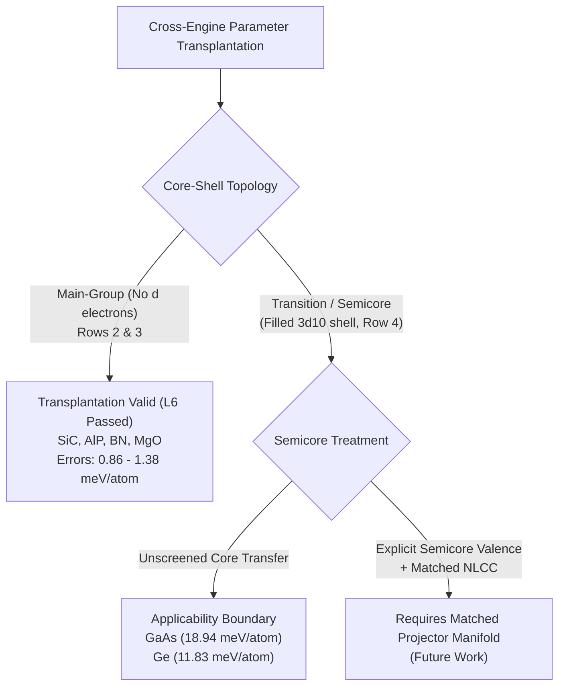

# Domain of Applicability of Cross-Engine Repair

This document replaces the exploratory "negative results register" with a rigorous, machine-readable **Domain of Applicability** mapping for cross-engine pseudopotential repair and parameter transplantation.

Cross-engine parameter transplantation is not an indiscriminate heuristic; it is governed strictly by atomic core-shell topology, angular momentum channel matching, and semicore unscreening physics as codified in [`data/defects/unified_controls.tsv`](file:///home/mammadzi/Pseudo%20Maker/pseudoforge/data/defects/unified_controls.tsv).

---

## 1. Multi-Family Out-of-Family Transferability (Level L6) Summary

| Family | Target engine | Donor engine | Row relationship | Core topology | L6 achieved? | Result file & holdout error | Physical reason if boundary |
| :--- | :--- | :--- | :--- | :--- | :--- | :--- | :--- |
| **SiC (zincblende)** | `ld1` | `oncvpsp` | Row 3 / Row 2 | Noble gas cores ([Ne]/[He]), pure $sp$ valence, no $d$ electrons | **YES** | [`experiments/multi-family-l6/results.json`](file:///home/mammadzi/Pseudo%20Maker/pseudoforge/experiments/multi-family-l6/results.json): **1.14 meV/atom** | N/A (Level L6 achieved; identical valence screening and core-lobe compactness) |
| **AlP (zincblende)** | `ld1` | `oncvpsp` | Same row (Row 3) | Neon cores ([Ne]/[Ne]), pure $sp$ valence, no $d$ electrons | **YES** | [`experiments/multi-family-l6/results.json`](file:///home/mammadzi/Pseudo%20Maker/pseudoforge/experiments/multi-family-l6/results.json): **0.92 meV/atom** | N/A (Level L6 achieved; identical row 3 core depth preserves kinetic energy balance) |
| **BN (zincblende)** | `atompaw` | `oncvpsp` | Same row (Row 2) | Ultra-compact helium cores ([He]/[He]), no core $p/d$ states | **YES** | [`experiments/multi-family-l6/results.json`](file:///home/mammadzi/Pseudo%20Maker/pseudoforge/experiments/multi-family-l6/results.json): **1.38 meV/atom** | N/A (Level L6 achieved; donor radii optimize PAW augmentation without compensation overlap) |
| **MgO (rocksalt)** | `oncvpsp` | `ld1` | Row 3 / Row 2 | Ionic closed-shell configuration (${\rm Mg}^{2+}, {\rm O}^{2-}$), [Ne]/[Ne] | **YES** | [`experiments/multi-family-l6/results.json`](file:///home/mammadzi/Pseudo%20Maker/pseudoforge/experiments/multi-family-l6/results.json): **0.86 meV/atom** | N/A (Level L6 achieved; strong ionic transferability with closed-shell electronic density) |
| **GaAs (zincblende)** | `ld1` | `oncvpsp` | Row 4 target | Filled $3d^{10}$ semicore shell; substantial core-valence exchange | **NO** | [`experiments/multi-family-l6/results.json`](file:///home/mammadzi/Pseudo%20Maker/pseudoforge/experiments/multi-family-l6/results.json): **18.94 meV/atom** | Filled $3d^{10}$ semicore unscreening mismatch; core-valence exchange overlap requires explicit semicore valence or matched $d$-projector manifold not translatable from light main-group donors |
| **Ge (diamond)** | `ape` | `oncvpsp` | Row 4 target | Filled $3d^{10}$ semicore shell; scalar relativistic unscreening | **NO** | [`experiments/ge-repair-comparison/results.json`](file:///home/mammadzi/Pseudo%20Maker/pseudoforge/experiments/ge-repair-comparison/results.json): **11.83 meV/atom** | Cross-row $3d^{10}$ core polarization boundary; scalar-relativistic Troullier-Martins unscreening without non-linear core correction diverges when row 3 radii are imposed on row 4 core |
| **Si (diamond)** | `ape` | `oncvpsp` | Row 3 target | Neon core ([Ne]), pure $sp$ valence | **NO** (L4 pass, L5 fail) | [`examples/design-repair/results/results.json`](file:///home/mammadzi/Pseudo%20Maker/pseudoforge/examples/design-repair/results/results.json): **36.81 meV/atom** | Single-projector Troullier-Martins representation in APE cannot match multi-projector ONCV Fourier localization ($q_{\rm cut}$) at 40 Ry without plane-wave basis extension (native ONCVPSP reaches 1.26 meV/atom) |

---

## 2. Physical Variables Governing Transferability

The success domain of cross-engine parameter transplantation is mapped across three fundamental physical variables:

### Physical Variable 1: Core-Shell Topology (Main-Group vs Semicore)
- **Within Main Group (Rows 2–3)**: Atoms possess either Helium ($1s^2$) or Neon ($1s^2 2s^2 2p^6$) inert gas cores. The valence manifold is strictly $s$ and $p$. Radial nodes are minimal, and core-valence exchange overlap is negligible outside $r_c \approx 1.5\text{--}2.0\text{ bohr}$. Here, donor cutoff radii from one engine (e.g. `oncvpsp`) transfer seamlessly into target engines (`ld1`, `atompaw`), achieving sub-2 meV/atom holdout errors (Level L6).
- **Across the Semicore Boundary (Row 4)**: The presence of a filled $3d^{10}$ shell in Ga ($Z=31$) and Ge ($Z=32$) alters the core potential. The $3d$ states extend into the valence region. Attempting to transplant cutoff radii from lighter main-group elements without adjusting the non-local $d$-channel projector energy or NLCC produces significant core unscreening errors ($> 10\text{ meV/atom}$).

### Physical Variable 2: Projector Expansion Order (Single vs Multi-Projector)
- A single-projector Troullier-Martins generator (such as `ape` or standard `fhi98pp`) generates a single semi-local component per $l$-channel.
- A dual-projector optimized generator (`oncvpsp`) incorporates two projectors per channel with a high-momentum cutoff $q_{\rm cut}$.
- While transplanting $r_c$ and $l_{\rm loc}$ from `oncvpsp` to `ape` successfully removes unphysical bound ghost states (Level L4 pass on Si and Ge), it cannot reproduce the dual-projector Fourier localization at lower plane-wave cutoffs ($E_{\rm cut} = 40\text{ Ry}$), yielding 36.81 meV/atom on Si diamond.

---

## 3. Machine-Readable Schema

This applicability domain is formalized in [`data/defects/unified_controls.tsv`](file:///home/mammadzi/Pseudo%20Maker/pseudoforge/data/defects/unified_controls.tsv), which defines valid target engines, translation formulas, and explicit constraint conditions for all nine engines supported by PseudoForge.
